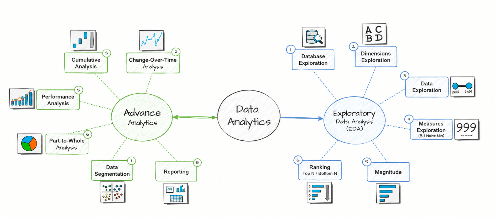

# SQL_data_analytics_project

The project has two main parts, and the scripts follow them:

### 1. Exploratory Data Analysis (EDA) — Scripts `01` to `06`

You get to know the data, from exploring database tables and dimensions to analysing dates, key metrics, and top-performing records.

### 2. Advanced Analytics — Scripts `07` to `13`

You go deeper into the data through change-over-time trends, running totals, performance analysis, part-to-whole analysis, and data segmentation.

Two reports close the project, one for customers and one for products.
